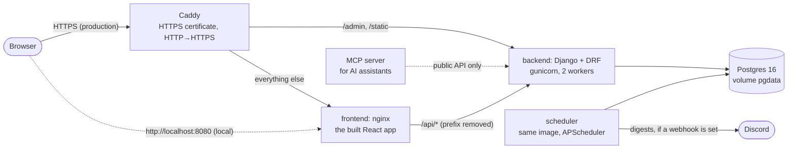

# Family Step Leaderboard

A family wants a light, friendly competition around daily walking. Everyone has a different watch, or none, so there's no one place to see who's ahead. This web app is that place: family members log their daily step totals, and the app ranks them on a **weekly board** (Monday to Sunday) and an **all-time board**, with medals, rank changes and callouts. Every Monday and on the 1st of each month it writes a digest of the standings, shows it in the app, and posts it to Discord if a webhook is set up.

**Live:** <https://159-89-228-242.sslip.io>. Join the **Demo Family** with the invite code `DEMO`. Every merge to `main` is tested and then deployed there.

- [What it does](#what-it-does)
- [Try it](#try-it)
- [Architecture](#architecture)
- [The database in each environment](#the-database-in-each-environment)
- [Run it with Docker](#run-it-with-docker)
- [Develop without Docker](#develop-without-docker)
- [Tests](#tests)
- [Deployment and CI/CD](#deployment-and-cicd)
- [Configuration](#configuration), and [connecting Discord](#connect-discord-optional)
- [AI-assisted development](#ai-assisted-development)
- [Security and operations](#security-and-operations)
- [Repository layout](#repository-layout)

## What it does

- **Families and members:** create a family and get a 6-character invite code; anyone with the code joins under a display name. No accounts, no passwords.
- **Logging steps:** a day's total for any day up to today, from 0 to 100,000. Logging the same day again replaces it. `POST /steps` also takes up to a year of days at once, for imports from watches later.
- **Boards:**
  - **Weekly:** Monday through today, compared with the same days last week.
  - **All-time:** everything since the family started, compared with the end of last month.
  - **Ranking:** ties share a rank (1, 1, 3), and the top three get 🥇🥈🥉.
  - **Callouts:** best single day, and most improved.
- **Digests:** the weekly one on Mondays at 8:00 AM and the monthly one on the 1st, Eastern time. Each is saved for the Messages page and posted to Discord when a webhook is configured. A failed post never loses a digest.
- **Eastern time everywhere:** a day ends at midnight `America/New_York`.

The full behavior and acceptance criteria are in [product-spec.md](product-spec.md); the design and its reasons in [docs/plan.md](docs/plan.md); the API in [openapi.yaml](openapi.yaml).

## Try it

On the live site, or locally after [`docker compose up`](#run-it-with-docker) at <http://localhost:8080>:

1. The Demo Family's weekly board shows first, filled with four weeks of demo steps. Switch to **All-time** for the totals.
2. Go to **Join or create**, enter the invite code `DEMO` and your name, then **Join**.
3. On **Log steps**, enter a big number for today and **Save**. Back on the board, you're ranked, likely with a medal.
4. Open **Messages** and choose **Send weekly digest now**. The digest appears in the list.

To use the admin (`/admin/`), create an account first: `docker compose exec backend python manage.py createsuperuser`.

## Architecture



| Part | Technology | What it does |
| --- | --- | --- |
| Frontend | React 18, Vite 7 ([frontend/](frontend/)) | Boards, logging steps, joining, messages. Every request goes through one client, [`src/api.js`](frontend/src/api.js) |
| Backend | Django 6.1, Django REST Framework ([backend/](backend/)) | The API in [openapi.yaml](openapi.yaml), validation (`422` with a `detail` message), ranking, digests, the admin. Applies migrations and loads the demo family when it starts |
| Scheduler | APScheduler, in the backend's image | Sends the weekly and monthly digests at 8:00 AM Eastern; never sends one twice |
| Database | Postgres 16 (SQLite locally and in tests) | Families, members, step entries (one per member and day), messages |
| Containers | Docker Compose ([docker-compose.yml](docker-compose.yml)) | The whole stack on one machine; production adds Caddy ([docker-compose.prod.yml](docker-compose.prod.yml)) |
| CI/CD | GitHub Actions ([ci.yml](.github/workflows/ci.yml)) | Tests, security scans and image builds on every push; deploys `main` |
| Hosting | One DigitalOcean server, Ubuntu, Docker | Only Caddy is reachable from the internet (ports 80 and 443) |
| MCP server | Python, the official MCP SDK ([mcp-server/](mcp-server/)) | Lets an AI assistant read the boards and log steps, through the public API |

The API has no logins: families join by invite code. That's a known, accepted risk while the live site holds only demo data ([security/pr-audit.md](security/pr-audit.md#2-no-authentication-high-by-design-accepted-for-now)).

## The database in each environment

| Where | Database | Set up by |
| --- | --- | --- |
| Tests (`pytest`) | SQLite, a fresh test database each run | Nothing: the default when `DATABASE_URL` isn't set |
| Development without Docker | SQLite, the file `backend/db.sqlite3` | `python manage.py migrate` |
| `docker compose up` | Postgres 16 in a container, data in the `pgdata` volume | Compose; the backend migrates on start |
| CI | Both: every backend test runs on SQLite **and** on Postgres | [ci.yml](.github/workflows/ci.yml) |
| Production | Postgres 16 in a container, its password only on the server | [docker-compose.prod.yml](docker-compose.prod.yml), [docs/deployment.md](docs/deployment.md) |

Django reads the database from `DATABASE_URL` (a `postgres://` or `sqlite:///` URL). Schema changes are migrations in [backend/leaderboard/migrations/](backend/leaderboard/migrations/), applied with `python manage.py migrate`; in Docker that happens on every start.

## Run it with Docker

You need [Git](https://git-scm.com/) and [Docker](https://docs.docker.com/get-docker/) (Docker Desktop on Windows or macOS). Nothing else, and no settings: everything has a local default.

```sh
git clone https://github.com/ChristianSpencer7/ai-dev-tools-proj.git
cd ai-dev-tools-proj
docker compose up --build
```

The first build takes a few minutes, then the logs scroll by. It's ready once the backend logs its first health check, `"GET /health HTTP/1.1" 200`, and the scheduler prints when the digests run next. On the very first start, Postgres also prints warnings such as `no usable system locales were found`; those are normal. Then:

- **The app:** <http://localhost:8080>
- **The API:** <http://localhost:8000/families>, for example (Django REST Framework's browsable pages)
- **The admin:** <http://localhost:8000/admin/>, after `createsuperuser` (see [Try it](#try-it))

`Ctrl+C` stops it. `docker compose down` removes the containers, and `docker compose down -v` also deletes the data, so the next start reloads the demo.

## Develop without Docker

You need **Python 3.12** or newer and **Node.js 20.19** or newer (24 LTS recommended), plus Git. The backend uses SQLite, so there's no database to install. Check with `python --version` and `node --version`; on macOS and many Linux systems the first is `python3`, so use that wherever these steps say `python`, until the virtual environment is active.

Stop the Docker version first if it's running (`docker compose down`): both use port 8000.

**1. Get the code and make a virtual environment.** Already cloned it for Docker? Skip the first two lines.

```sh
git clone https://github.com/ChristianSpencer7/ai-dev-tools-proj.git
cd ai-dev-tools-proj
python -m venv .venv                 # at the repository root: the agent hooks look for it there
```

**2. Activate it**, in the same terminal. Your prompt then starts with `(.venv)`.

| On | Command |
| --- | --- |
| Windows, PowerShell | `.venv\Scripts\Activate.ps1`. If it says running scripts is disabled, run `Set-ExecutionPolicy -Scope CurrentUser RemoteSigned` once, then try again |
| Windows, Command Prompt | `.venv\Scripts\activate.bat` |
| macOS, Linux | `source .venv/bin/activate` |

**3. The backend**, at <http://localhost:8000>. It keeps running in this terminal:

```sh
cd backend
pip install -e ".[dev]"
python manage.py migrate
python manage.py seed_demo           # the Demo Family, invite code DEMO
python manage.py runserver
```

**4. The frontend**, at <http://localhost:5173>. Open a second terminal **in the project folder** (`ai-dev-tools-proj`); no virtual environment needed. It sends `/api` to the backend on port 8000:

```sh
cd frontend
npm ci
npm run dev
```

If `npm ci` warns `EBADENGINE`, or `npm run dev` fails, check `node --version`: it needs 20.19 or newer. After installing a newer Node, open a new terminal.

## Tests

| What | Command | Where |
| --- | --- | --- |
| Backend unit tests: one module at a time | `pytest tests/unit` | `backend/`, with the virtual environment active ([step 2](#develop-without-docker)) |
| Backend integration tests: through the HTTP API, including whole user journeys and the `openapi.yaml` contract | `pytest tests/integration` | `backend/` |
| Both, and a missing-migration check | `pytest` and `python manage.py makemigrations --check --dry-run` | `backend/` |
| Frontend tests and build | `npm test` and `npm run build` | `frontend/` |
| The agent hooks and the ops redaction | `python -m pytest ../agent-hooks/tests ../ops/tests -p no:django` | `backend/` |
| The MCP server | see [mcp-server/README.md](mcp-server/README.md) | `mcp-server/`, in its own environment |

The backend tests always run on SQLite unless `DATABASE_URL` points elsewhere; CI runs them on Postgres too. What goes where, and why, is in [backend/tests/README.md](backend/tests/README.md). No test reaches real Discord: [backend/tests/conftest.py](backend/tests/conftest.py) fails any that tries.

## Deployment and CI/CD

**Deploying is merging.** Every push and pull request runs CI; a merge to `main` also deploys, once every check has passed:

1. **Checks:** the backend tests (on SQLite and on Postgres), the frontend tests and build, the MCP server's tests, the security scans (Bandit, pip-audit, npm audit, gitleaks), and the Docker images, scanned with Trivy.
2. **Deploy:** GitHub Actions connects to the server with an SSH key that can only run [scripts/deploy.sh](scripts/deploy.sh). The script updates the server's copy to `main`, rebuilds, and waits for every service to be healthy.
3. **Check:** CI confirms the live site answers: health, API and page.

Setting up a server from scratch, the secrets, backups and rolling back are in [docs/deployment.md](docs/deployment.md).

## Configuration

Everything is set by environment variables, all optional for local use. To change one, copy [.env.example](.env.example) to `.env` at the repository root; it lists them all. `.env` is never committed.

| Setting | Default | What it's for |
| --- | --- | --- |
| `DISCORD_WEBHOOK_URL` | none | Posts digests to a Discord channel; see [below](#connect-discord-optional). Without it, digests appear only on the Messages page |
| `DATABASE_URL` | SQLite file; Postgres in Docker | Which database |
| `DJANGO_DEBUG`, `DJANGO_SECRET_KEY`, `DJANGO_ALLOWED_HOSTS` | debug on, a local-only key, localhost | Django; production sets all three |
| `SITE_ADDRESS`, `POSTGRES_PASSWORD` | none | Production only ([docs/deployment.md](docs/deployment.md)) |

### Connect Discord (optional)

1. **Make a webhook.** In the Discord channel for the digests: **Edit Channel** → **Integrations** → **Webhooks** → **New Webhook**, then **Copy Webhook URL**. This needs the "Manage Webhooks" permission.
2. **Give it to the app.** In the project folder, copy `.env.example` to `.env` (PowerShell: `Copy-Item .env.example .env`), and set `DISCORD_WEBHOOK_URL=` to the URL. Then `docker compose up -d`, which restarts the backend and scheduler with it; without Docker, restart `runserver`.
3. **Try it.** In the app, **Messages** → **Send weekly digest now**. It should appear in the channel, with the status `sent` in the app. If it says `failed`, the [runbook](ops/runbook.md#a-digest-didnt-arrive) says why.

From then on, the scheduler posts every Monday and on the 1st. On the live site, the URL goes in the server's `.env` instead ([docs/deployment.md](docs/deployment.md#changing-a-secret)).

- **The URL works like a password:** anyone with it can post to the channel. It belongs only in `.env`, which is never committed; don't paste it into an AI chat. If it leaks, delete the webhook in Discord and make a new one.
- **One webhook serves the whole app,** so every family's digests go to the same channel. That's why the scheduler leaves out the Demo Family.

## AI-assisted development

The project was built with Claude Code, one backlog task at a time, with a person deciding, reviewing and approving every commit.

| | |
| --- | --- |
| [docs/ai-workflow.md](docs/ai-workflow.md) | **How it was built:** the working loop, each task's prompts, what was checked, what verification caught, the AI's mistakes, and the developer's decisions |
| [AGENTS.md](AGENTS.md) | Instructions every AI agent reads: layout, commands, rules |
| [docs/agent-extension-pack.md](docs/agent-extension-pack.md) | **The agent extension pack:** project instructions, the MCP server, a reusable workflow (skill), a specialist reviewer agent, hooks, permissions; how to install and use each |
| [docs/permissions.md](docs/permissions.md) | What each piece may read, run and change |
| [security/ai-policy.md](security/ai-policy.md) | **Which AI tools may be used, with what data, and when a person reviews** |

## Security and operations

| | |
| --- | --- |
| [security/](security/README.md) | Scans and their findings (fixed or accepted, and why), a security audit of a real pull request, and the risks of AI agents |
| [ops/](ops/README.md) | A diagnosis of the production server, with real output from planned failures, and the [runbook](ops/runbook.md): what to do when something's wrong |

## Repository layout

| Path | What's there |
| --- | --- |
| [backend/](backend/) | The Django project (`stepboard/`), the app (`leaderboard/`), and the tests (`tests/unit/`, `tests/integration/`) |
| [frontend/](frontend/) | The React app; `src/api.js` is its only route to the backend |
| [openapi.yaml](openapi.yaml) | The API contract: changed first, and checked by the contract tests |
| [mcp-server/](mcp-server/), [.mcp.json](.mcp.json) | The MCP server, and its registration for Claude Code |
| [.claude/](.claude/), [agent-hooks/](agent-hooks/), [agent-capabilities/](agent-capabilities/), [custom-agent/](custom-agent/) | The rest of the agent extension pack |
| [docker-compose.yml](docker-compose.yml), [docker-compose.prod.yml](docker-compose.prod.yml), [Caddyfile](Caddyfile), [scripts/](scripts/) | Running it locally and in production |
| [.github/workflows/](.github/workflows/) | CI and deployment |
| [docs/](docs/) | The plan, the backlog, deployment, the AI workflow log, the extension pack, permissions |
| [security/](security/), [ops/](ops/) | Security work and operations |
