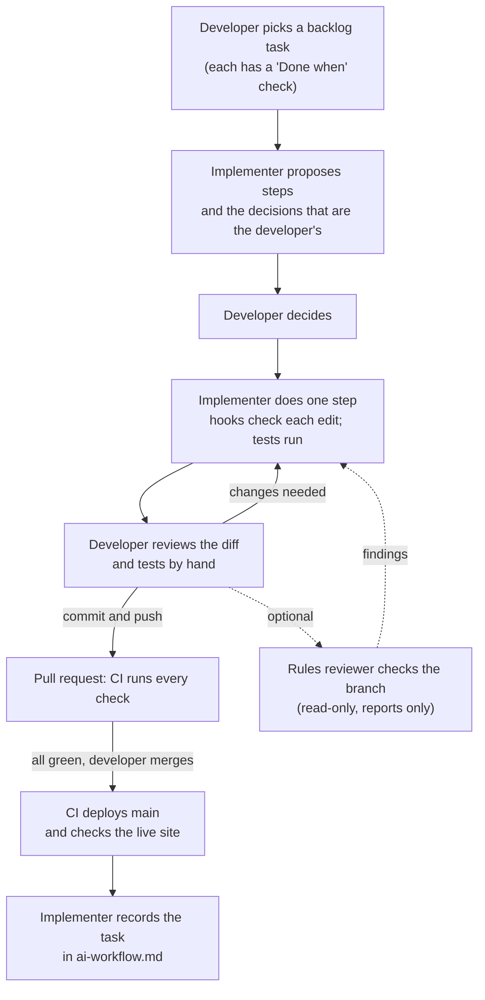

# Agent team

Who works on this project, what each member may do, and how work passes between them. One person directs and approves. One AI agent implements. A second, read-only agent can review a branch when asked. Hooks and CI check every change automatically. Every agent reads [AGENTS.md](../AGENTS.md) first.

## The team

| Member | What it is | Responsible for | Limits |
| --- | --- | --- | --- |
| **Developer** | Christian | Choosing the next backlog task, deciding open questions, reviewing every diff, testing by hand, approving every commit, merging, the server and its secrets | Never shares secrets, real family data or unredacted server logs with an AI tool ([AI policy](../security/ai-policy.md)) |
| **Implementer** | Claude Code (Claude Opus 5.5) in VS Code, the main session | Breaking a task into steps, writing code, tests and docs one step at a time, verifying its own work before reporting it, and recording each task in [ai-workflow.md](ai-workflow.md) | Doesn't commit or push unless asked. Can't read `.env` or change committed migrations ([permissions.md](permissions.md)) |
| **Rules reviewer** | The [`leaderboard-rules-reviewer`](../.claude/agents/leaderboard-rules-reviewer.md) subagent | Checking a branch against 12 product rules from [product-spec.md](../product-spec.md) and `AGENTS.md`, running the related tests, and reporting findings with `file:line` | Read-only: no edit tools, and [its own hook](../agent-hooks/read_only_commands.py) allows only reading commands and tests |
| **Security auditor** | Claude Code, asked by the developer | Auditing a merged pull request against a security checklist, done once for the MCP server ([PR audit of #4](../security/pr-audit.md)) | Reports findings; the developer decides what's fixed and what's accepted |
| **Guardrail hooks** | [`guard_files.py`](../agent-hooks/guard_files.py) and [`contract_check.py`](../agent-hooks/contract_check.py) | Blocking changes to `.env`, database files and committed migrations; running the contract tests after every API edit | They check a command's text, so they make mistakes hard, not impossible ([permissions.md](permissions.md#limits)) |
| **CI** | [GitHub Actions](../.github/workflows/ci.yml) | Backend tests on SQLite and Postgres, frontend and MCP server tests, security scans, image builds, then deploying `main` and checking the live site | Deploys only `main`, and only after every check passes |

## How work passes between them

This is the defined workflow. The developer–implementer loop (steps 1 to 4) is how every backlog task was built, as [ai-workflow.md](ai-workflow.md) records task by task. CI was added in task 11, and the hooks and the rules reviewer in task 14. Dashed lines are optional.

1. **The developer picks the next task** from [docs/backlog.md](backlog.md), for example *"let's move to task 12"*. Each task has a "Done when" check.
2. **The implementer plans it:** numbered steps, the gotchas, and each decision that belongs to the developer, with a recommendation.
3. **The developer decides**, and the implementer works **one step at a time**. The guard hook runs before every edit and shell command; the contract check runs after every API edit. The implementer runs the tests and reports what it checked and what it didn't.
4. **The developer reviews** the summary and the diff, tests by hand when the step is user-facing, and says *"commit and push"*.
5. **Optional: a specialist review.** Before a pull request, the developer can ask the read-only rules reviewer to check the branch against the product rules. It can't fix anything, so any findings go back to the implementer as a new step, and the developer decides which to act on. The reviewer was added in task 14; the workflow log doesn't yet record it reviewing a branch.
6. **CI runs every check on the pull request.** The developer merges once they pass; CI deploys `main` and confirms the live site answers.
7. **The implementer records the task** in [ai-workflow.md](ai-workflow.md): the prompts, what was checked, and what verification caught.