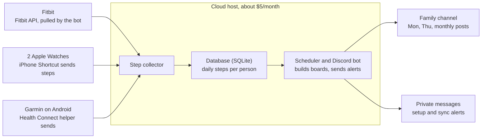

# Family Step Leaderboard — Design Plan

Last updated: Oct 10, 2026

## Overview

A Discord bot collects each family member's daily steps from their watch and posts a weekly leaderboard every Monday plus an all-time leaderboard on the 1st of each month.

- **Built as:** one Python app that fetches steps, stores them in a small database, and posts to a family Discord channel
- **Hosted on:** a cloud service at about $5/month
- **Scoring:** weekly totals (Monday–Sunday) and an all-time total starting at zero on launch day
- **Time zone:** Eastern for everyone; a day ends at midnight Eastern

## Family members and data sources

Four people, three ways of getting steps in: a cloud connection for Fitbit, an iPhone Shortcut for Apple Watch, and an Android helper for Garmin.

| Person | Device | Phone | How steps reach the bot | Automatic? |
| --- | --- | --- | --- | --- |
| Member 1 | Fitbit | Any | Fitbit Web API; the bot pulls steps after a one-time sign-in | Yes |
| Member 2 | Apple Watch | iPhone | iPhone Shortcut reads Apple Health and sends daily steps to the bot | Yes, via a daily automation |
| Member 3 | Apple Watch | iPhone | Same Shortcut as Member 2 | Yes, via a daily automation |
| Member 4 | Garmin | Android | Garmin Connect → Android Health Connect → small helper sends daily steps to the bot | Yes, once set up |

Manual logging (`/log 12450` in Discord) stays available to everyone as a backup if a sync breaks.

## System architecture



The bot pulls Fitbit steps itself; the iPhone Shortcut and Android helper push steps to the bot's web address. Everything else runs inside one cloud app.

## Leaderboards and scoring

Two leaderboards, both ranked by total steps from most to fewest.

| Leaderboard | Counts | Resets | Posted |
| --- | --- | --- | --- |
| Weekly | Steps Monday 12:00 AM through Sunday 11:59 PM Eastern | Every Monday | Mondays, plus midweek standings Thursdays |
| All-time | Every step since launch day | Never | 1st of each month |

- Everyone starts at zero on launch day, so no one is advantaged by how much history their device keeps.
- A day's steps can still change until the device finishes syncing. Posts use the latest numbers available at post time.
- Ties: not decided yet (see Open questions).

## Discord posts

The bot posts three scheduled messages to the family channel, all at 8:00 AM Eastern.

| Post | When | Shows |
| --- | --- | --- |
| Weekly leaderboard | Every Monday | Final standings for the week that just ended |
| Midweek update | Every Thursday | Standings so far this week (Monday–Wednesday) |
| All-time leaderboard | 1st of each month | Running totals since launch day |

Each leaderboard message includes:

- Medals for the top three (🥇🥈🥉), then numbered ranks
- Change from last week: rank movement (▲ / ▼ / —) and step difference
- Fun callouts, such as best single day and most improved

Sample weekly post:

```
🏆 Weekly Steps — Oct 5–11
🥇 Dad — 84,210 (▲ 1)
🥈 Mom — 79,455 (▼ 1)
🥉 Alex — 61,980 (—)
4. Sam — 52,300 (▲ +6,100 steps)

🔥 Best single day: Mom, 18,203 on Wednesday
🚀 Most improved: Sam, +6,100 from last week
```

Names and numbers above are examples only.

## Onboarding with /join

Each person sets up their own connection. The bot guides them through it in a private message.

1. They type `/join` in the family Discord server.
2. The bot asks which device they use: Fitbit, Apple Watch, or Garmin.
3. The bot privately sends device-specific steps:
   - **Fitbit:** a personal sign-in link. They approve access, and the bot starts pulling steps.
   - **Apple Watch:** a link to install the Shortcut, plus a personal code to paste in once. They also set a daily automation (for example, 11:30 PM) so it runs on its own.
   - **Garmin on Android:** instructions to turn on Garmin's Health Connect sync, then install and link the helper with their personal code.
4. The bot confirms once the first steps arrive, and the person appears on the next leaderboard.

The personal code ties incoming steps to the right person and keeps others from posting steps under their name.

## Reliability

Three safeguards keep a broken sync from costing anyone steps.

- **Sync alerts:** if a person's steps haven't updated in 2 days, the bot sends them a private message with a reminder and a link to their setup steps.
- **Backfill:** when a connection comes back, the bot fills in the missed days. Fitbit can be re-queried by date. The Shortcut and Android helper send the last 7 days each run, so gaps fill in automatically.
- **Manual backup:** `/log <steps>` records a day by hand if a device can't sync.

## Hosting and cost

The bot runs on a small cloud service, such as Railway, Render, or a DigitalOcean server, for about $5/month.

- **Always on:** needed for scheduled posts and incoming step data
- **Public web address:** Fitbit sign-ins, the Shortcut, and the Android helper all send data to it
- **Database:** a single SQLite file on the host, backed up regularly
- **Other costs:** Discord bot and Fitbit API are free; the Health Sync app, if needed, may have a small fee

## Tech stack

One Python process runs the Discord bot, the web endpoint, and the scheduler on a single asyncio event loop.

| Piece | Choice |
| --- | --- |
| Language | Python 3.12 |
| Discord bot | `discord.py` (slash commands, channel posts, private messages) |
| Web endpoint | FastAPI served by uvicorn, in the same event loop as the bot |
| Scheduler | APScheduler `AsyncIOScheduler`, time zone `America/New_York` (added in phase 2) |
| Database | SQLite (WAL mode), backed up continuously with Litestream to S3-compatible storage |
| Fitbit | `httpx` with OAuth2 and stored refresh tokens (phase 3) |
| Garmin helper | Small Kotlin app reading Health Connect, or a Tasker/Automate flow (decided in phase 5) |
| Host | ~$5 VPS (DigitalOcean or Hetzner), or Railway/Fly.io with a persistent volume |

## Build phases

Build in five phases, each one usable on its own before moving to the next.

1. **Core bot:** Discord bot, database, `/log` manual entry, and leaderboard math. Test with hand-entered steps.
2. **Scheduled posts:** Monday weekly, Thursday midweek, and monthly all-time posts with medals, changes, and callouts.
3. **Fitbit:** sign-in link through `/join`, daily step pulls, and backfill.
4. **Apple Watch:** web endpoint for incoming steps, the Shortcut, personal codes, and setup instructions.
5. **Garmin on Android:** confirm the Health Connect path, then build or set up the helper.

Then: deploy to the cloud host, add sync alerts, and pick launch day so everyone starts at zero together.

## Risks and open questions

The Garmin-on-Android path is the biggest unknown; everything else uses well-established tools.

**Risks**

- **Garmin → Health Connect:** whether Garmin Connect writes steps to Health Connect directly or needs a sync app in between. Confirm this in build phase 5. Fallback: manual `/log`.
- **Apple Shortcut automations:** iOS may ask for confirmation or skip a run if the phone is off. The 7-day resend and sync alerts cover missed days.
- **Step counts differ by device:** different watches count steps slightly differently. This is accepted as part of the game.

**Open questions** (can be added later)

- [ ] How are ties broken: shared rank, or whoever had the best single day?
- [ ] Can family members see each other's daily numbers, or only weekly totals?
- [ ] How does a new family member join later, and do they start at zero on the all-time board?
- [ ] Launch day date
