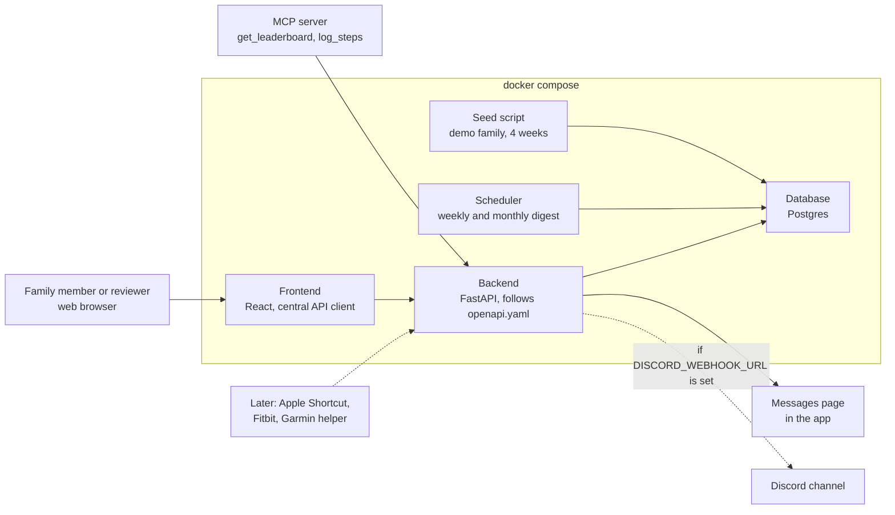

# Family Step Leaderboard — Design Plan

Last updated: Oct 12, 2026

## Overview

A full-stack web app where a family logs daily steps and competes on two leaderboards: a weekly board (Monday–Sunday) and an all-time board. The app builds a weekly and a monthly leaderboard message, which it posts to Discord when a webhook is configured and always shows in the app.

The app is designed for the course's final project, so it must run and make sense for a peer reviewer who has no smartwatch and no family. Watches are optional, demo data comes built in, and Discord needs no setup.

- **Frontend:** React (Vite), with one central API client
- **Backend:** FastAPI (Python), following `openapi.yaml`
- **Database:** Postgres; SQLite for tests
- **Runs with:** `docker compose up`, which also loads demo data
- **Time zone:** Eastern for everyone; a day ends at midnight Eastern

## Design principles

1. **Works without a watch.** Manual entry and a JSON import endpoint are the core ways steps get in. Watch integrations come later.
2. **Meaningful on first load.** Seed data fills the leaderboards, so a reviewer sees medals, rank changes and callouts right away.
3. **No outside accounts needed.** Discord is optional. Without a webhook URL, messages appear on an in-app Messages page.
4. **Small enough for 8 days.** The app gets about 4 days; the rest goes to testing, deployment, the agent extension pack and security work.

## How steps get in

| Source | How it works | In the 8-day scope? |
| --- | --- | --- |
| Manual entry | A member logs steps for any day in the web app | Yes |
| Import endpoint | `POST /steps` accepts daily totals as JSON | Yes |
| Seed data | A script creates a demo family with about 4 weeks of history | Yes |
| Apple Watch | An iPhone Shortcut sends daily totals to the import endpoint | Later |
| Fitbit | A sync job pulls from the Fitbit API and writes through the same path; on only when keys are configured | Later |
| Garmin (Android) | Health Connect helper sends to the import endpoint | Later |

When a member logs the same day twice, the newer total replaces the older one rather than adding to it.

## System architecture



The frontend talks to the backend only through the API in `openapi.yaml`. The MCP server, from the agent extension pack, uses the same API. The scheduler runs inside the backend's code and writes digests to the database directly; it doesn't call the API.

## Leaderboards and scoring

| Leaderboard | Counts | Resets |
| --- | --- | --- |
| Weekly | Steps Monday 12:00 AM through Sunday 11:59 PM Eastern | Every Monday |
| All-time | Every step since the family's start date | Never |

- Each family starts at zero on its own start date (launch day for the real family).
- Ranked by total steps, most to fewest.
- **Medals** for the top three (🥇🥈🥉), then numbered ranks.
- **Change from last week:** rank movement (▲ / ▼ / —) and step difference.
- **Fun callouts:** best single day and most improved.
- Ties: shared rank for now (see open questions).

## Messages

| Message | When | Shows |
| --- | --- | --- |
| Weekly digest | Mondays at 8:00 AM Eastern | Final standings for the week that just ended |
| Monthly digest | 1st of each month at 8:00 AM Eastern | All-time totals |

Each digest is saved and shown on the Messages page. If `DISCORD_WEBHOOK_URL` is set, it is also posted to Discord with one HTTP request. A "Send digest now" action lets reviewers generate one on demand.

Sample weekly digest:

```
🏆 Weekly Steps — Oct 5–11
🥇 Dad — 84,210 (▲ 1)
🥈 Mom — 79,455 (▼ 1)
🥉 Alex — 61,980 (—)
4. Sam — 52,300 (▲ +6,100 steps)

🔥 Best single day: Mom, 18,203 on Wednesday
🚀 Most improved: Sam, +6,100 from last week
```

Names and numbers above are examples only.

## Reviewer experience

1. Clone the repo and run `docker compose up`.
2. Open the app: the demo family's weekly and all-time boards are already filled.
3. Join the demo family (or create a new one) and log a few days of steps.
4. Watch your rank change, then open Messages and send a digest.

## In scope and cut

**In scope:** families, members, daily step entries, the import endpoint, both leaderboards with medals, changes and callouts, weekly and monthly digests, optional Discord webhook, seed data.

**Cut for now:** watch integrations, the Discord bot (`/join`, slash commands, private messages), sync alerts, and the Thursday midweek post. Each can be added later without changing the core design.

## Repository layout

Matches the course's expected contents:

```
README.md
product-spec.md
AGENTS.md
openapi.yaml
docker-compose.yml
frontend/
backend/
.github/workflows/
docs/
security/
ops/
agent-capabilities/
agent-hooks/
mcp-server/
plugins/ or custom-agent/
docs/agent-extension-pack.md
docs/permissions.md
```

## 8-day plan

| Day | Focus |
| --- | --- |
| 1 | `product-spec.md`, `openapi.yaml`, `AGENTS.md`, repo skeleton, `docker-compose.yml` |
| 2 | Backend endpoints, database, seed script, unit tests |
| 3 | Leaderboard and callout logic, digest and webhook, integration tests |
| 4 | Frontend with one central API client, plus frontend tests |
| 5 | CI/CD (tests, then deploy) and cloud deployment |
| 6 | Agent extension pack |
| 7 | Security scans, PR audit, ops diagnosis, AI tool/data policy |
| 8 | README, end-to-end run from a fresh clone, buffer |

## Agent extension pack

The MCP server offers tools such as `get_leaderboard` and `log_steps`, so an AI assistant can answer "who's winning this week?" or log steps for you. That gives the extension pack a real use built on the project's own API. The pack also includes project instructions, a reusable workflow, a specialist agent, a hook or guardrail, and permission notes.

## After the course

The family can keep using the app. Adding the Apple Shortcut, Fitbit sync or Garmin helper only means sending data to the import endpoint that already exists. The Discord bot and sync alerts can come back as extras.

## Open questions

- [ ] Ties: shared rank, or whoever had the best single day?
- [ ] Login: simple accounts, or family invite code only?
- [ ] Can members see each other's daily numbers, or only weekly totals?
- [ ] Cloud host for deployment
- [ ] Launch day for the real family
